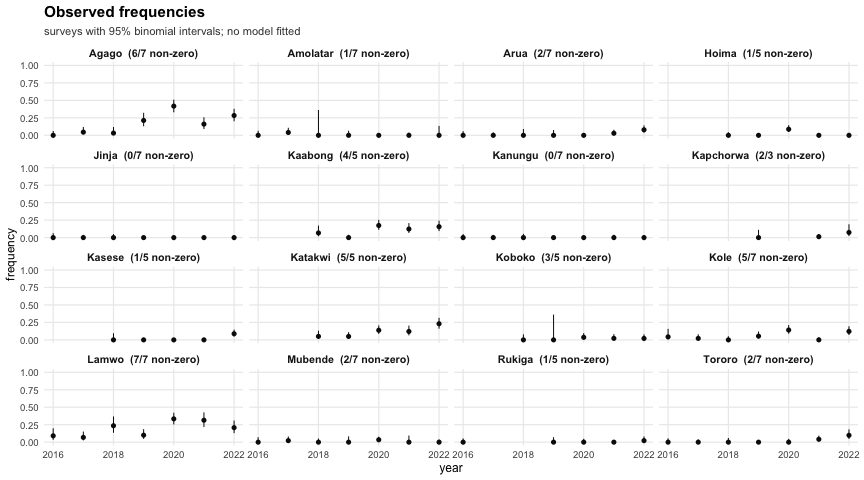
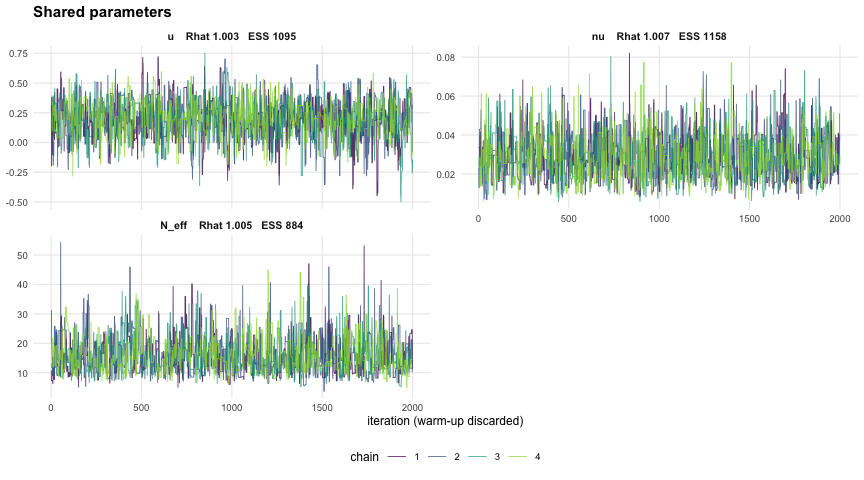
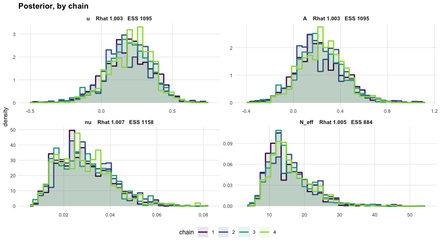
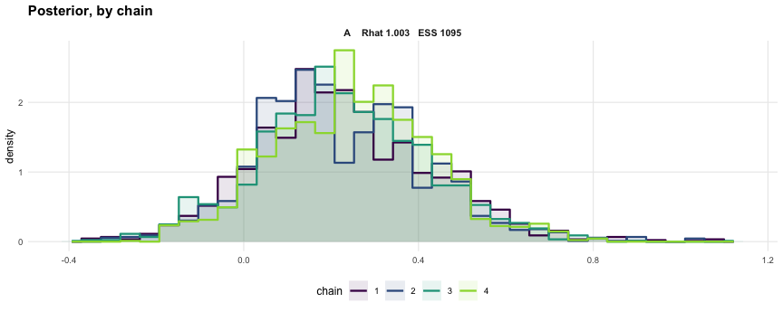
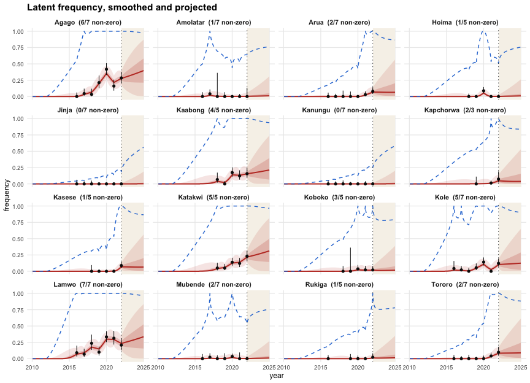
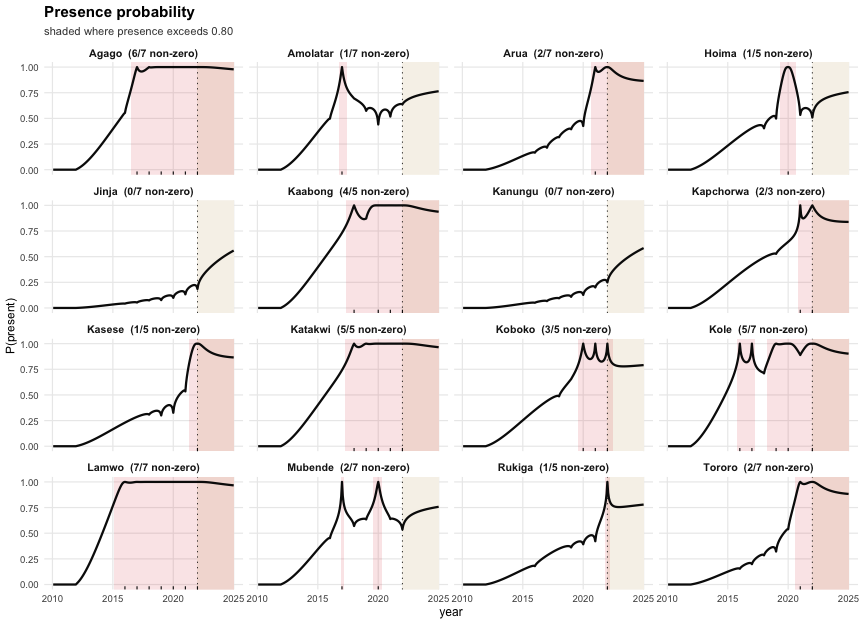
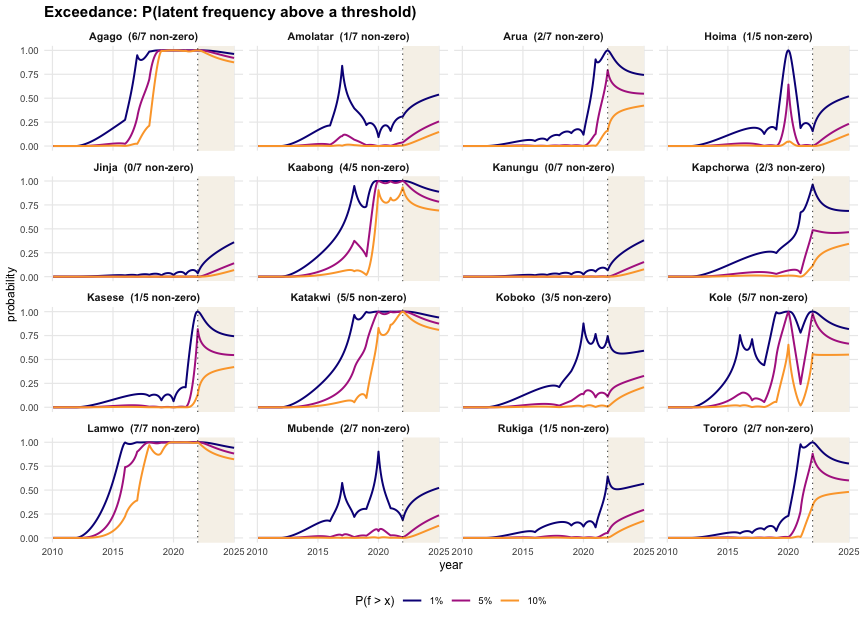
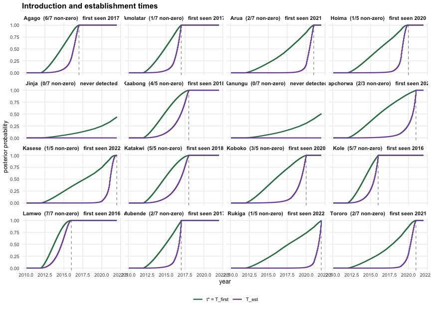
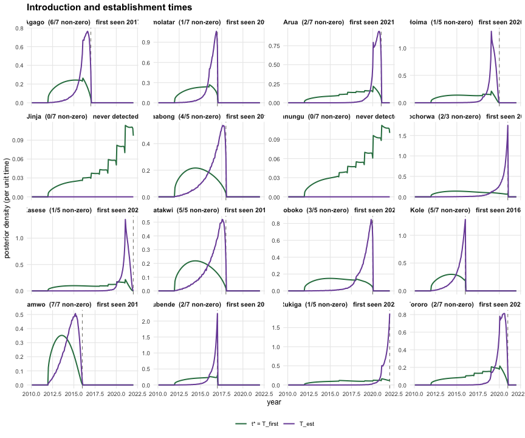

GeneCastR: Quickstart
================

This package takes prevalence surveys for a genetic marker and fits a
model of how that marker prevalence changes through time to answer
questions such as

- **is the prevalence increasing, and how fast?**
- **what frequency is it likely to be in a few years’ time?**
- **when did it arrive at each site?**

``` r
library(GeneCastR)
```

## The data

Input is one row per survey, with a site, a time, the number positive
and the number tested. The example is sixteen Ugandan districts surveyed
annually from 2016 to 2022 for the PfKelch13 C469Y
artemisinin-resistance marker.

``` r
d <- gc_example_data(M = 16)
#> 16 row(s) with n == 0 dropped (no information).
head(d$surveys, 4)
#>    deme time  x  n step          f         lo         hi
#> 1 Agago 2016  0 30   16 0.00000000 0.00000000 0.06151672
#> 2 Agago 2017  2 44   32 0.04545455 0.01315698 0.12016535
#> 3 Agago 2018  1 31   48 0.03225806 0.00570508 0.11934267
#> 4 Agago 2019 10 47   64 0.21276596 0.12864448 0.32229633
```

`gc_example_data()` is a convenience wrapper, for an arbitrary data
frame one format the data using:

``` r
d <- GCData$new(surveys, M = 16,
                cols = c(deme = "district", time = "year",
                         x = "n_positive", n = "n_tested"))
```

where `cols` says which column is which.

- **`time` can be a number or a date.** A plain `2016` is taken as
  given. A `Date` or `POSIXct` column is converted to a decimal year –
  `2016-07-01` becomes 2016.497.
- **Rows where nothing was tested are dropped**, with a message. Survey
  extracts routinely carry a row for a site-year that was not sampled.

`M` sets the time resolution: how many steps the model takes per unit of
`time`. At `M = 16` with reports at yearly resolustions, the model moves
in roughly $52/M \approx$ three-week steps. Finer is slower, and the
answers stop changing well before the resolution becomes a concern; 16
is a reasonable default for annual data.

``` r
d
#> <GCData>
#>   demes    : 16 (Agago, Amolatar, Arua, ...)
#>   surveys  : 96 (42 non-zero)
#>   window   : 2015 to 2022   M = 16, T = 112 steps
#>   never positive: 2 deme(s) -- Jinja, Kanungu
```

One can visualise the data by calling:

``` r
gc_plot_data(d)
```

<!-- -->

## Fitting

Here’s an example of a fit object:

``` r
stored <- gc_example_tstar_fit()$panel
fit <- stored$fit
pr <- stored$pr
fit
#> <GCFit>  Poisson flow, t* t_min + negative binomial
#>           (t* = the first non-zero draw)
#>   data    : 16 demes, 96 surveys, M = 16, T = 192
#>   window  : 2010 to 2022, lead-in 96 steps
#>   chains  : 4 x 4000 (2000 warm-up), 8000 draws retained
#>   time    : 415.8 s on 4 cores
#> 
#>           variable  median      q5     q95 rhat ess_bulk
#>                  u  0.1982 -0.0737  0.4407 1.00     1095
#>                  A  0.2193 -0.0711  0.5537 1.00     1095
#>                 nu  0.0275  0.0130  0.0496 1.01     1158
#>              N_eff 14.5036  8.2957 26.8980 1.01      884
#>        tstar_shape  1.6507  1.0650  3.5436 1.01     1231
#>  p_beyond_baseline  0.1057  0.0523  0.1322 1.01     1231
```

A fit of this size takes several minutes on four cores; this vignette
shows a stored result. The call that produced it was

``` r
fit <- GCFit$new(d, chains = 4, iter = 4000, warmup = 2000, cores = 4,
                 lead_in = 6 * 16,
                 control = gc_control(tstar_min = 2012, tstar_mean = 2017))
```

`chains` and `iter` are the usual Markov chain settings and `cores` runs
the chains in parallel over the number of specified cores. The other
three arguments are priors about arrival time:

- **`lead_in`** is how far back before the first survey the model is
  allowed to look, counted in model steps, so `6 * 16` is six years at
  `M = 16`.
- **`tstar_min`** is the earliest year the marker could have arrived
  anywhere. Nothing before it is entertained.
- **`tstar_mean`** is roughly when arrival is expected, on average
  across sites.

We can let `tstar_min` and `tstar_mean` be deme specific. They take
either one value for the whole panel, as above, or one value per site.
For per-site values, pass a vector named by site:

``` r
fit <- GCFit$new(d, chains = 4, iter = 4000, warmup = 2000, cores = 4,
                 lead_in = 6 * 16,
                 control = gc_control(
                   tstar_min  = c(Koboko = 2012, Arua = 2012, Kanungu = 2014),
                   tstar_mean = c(Koboko = 2016, Arua = 2016, Kanungu = 2019)))
```

The names are checked against the data, and a `tstar_min` falling after
a site’s own first positive survey is refused, since the two would
contradict each other. `lead_in` stays a single number for the panel: it
only has to reach back far enough for the earliest `tstar_min`.

### Checking the fit

Two columns of the printout at the start of the **Fitting** section give
an indication of whether the MCMC fit has converged, and whether the
estimates that follow should be retained.

**`rhat`** compares the four chains. If they explored the same region it
sits at 1.00. Anything above about 1.05 means they did not agree and the
fit should be run for longer; the printout says so when it happens.

**`ess_bulk`** is how many independent draws the correlated ones are
worth.

The chains themselves should look like stationary noise with no
wandering:

``` r
gc_plot_trace(fit)
```

<!-- -->

``` r
gc_plot_hist(fit)
```

<!-- -->

The histograms present posterior histograms for each parameter, we
should hope for each chain to sit in the same place.

## Is the marker spreading?

`A` is the growth advantage: the proportional change in the marker’s
frequency per year that selection buys it. An `A` of 0.2 is roughly a
fifth faster per year than a neutral marker would manage, and an `A` of
zero is no advantage at all.

``` r
gc_plot_hist(fit, "A", ncol = 1)
```

<!-- -->

``` r
A <- as.numeric(posterior::as_draws_matrix(fit$draws)[, "A"])
round(stats::quantile(A, c(.025, .5, .975)), 3)
#>   2.5%    50%  97.5% 
#> -0.123  0.219  0.628
c(`P(A > 0)` = mean(A > 0), `P(A > 0.25)` = mean(A > 0.25))
#>    P(A > 0) P(A > 0.25) 
#>    0.898625    0.446375
```

That is the estimate of the advantage, a 95% interval around it, and the
probability that there is any advantage at all.

## Projections and probability of presence

We can create projections to forecast future frequencies, the object
looks like this

``` r
pr
#> <GCProjection>
#>   3840 rows: 16 demes x 240 steps (192 smoothed, 48 projected)
#>   window   : 2010.062 to 2025
#>   draws    : 400, 400 paths each
#>   exceedance thresholds: 0.01, 0.05, 0.1
#>   P(t* beyond the record): mean 0.066, max 0.561
#> 
#>   at 2025: mean P(present) 0.825, mean median f 0.106
```

and is created by running

``` r
pr <- fit$project(horizon = 3, n_paths = 400)
```

`horizon = 3` projects three years past the last survey. Inside the
survey window the curves are *smoothed*: every survey at a site, later
ones included, informs the estimate at every time. Past the last survey
the same model carries that state forward.

``` r
gc_plot_frequency(pr)
```

<!-- -->

The probability of presence $p(k_t>0)$ can by visualised using:

``` r
gc_plot_present(pr)
```

<!-- -->

And exceedance probabilities $p(f_t>\text{threshold})$:

``` r
gc_plot_exceed(pr)
```

<!-- -->

All of these can be produced by `pr$curves`, one row per site and time
step, for the numbers rather than the pictures:

``` r
head(pr$curves[, c("deme", "time", "f_mean", "p_present", "p_exceed_5")], 4)
#>    deme     time f_mean    p_present p_exceed_5
#> 1 Agago 2010.062      0 1.970646e-17          0
#> 2 Agago 2010.125      0 1.887379e-17          0
#> 3 Agago 2010.188      0 1.720846e-17          0
#> 4 Agago 2010.250      0 1.942890e-17          0
```

Note that presence need not rise steadily. It dips between surveys and
recovers at each positive one, again because the marker can die out
locally and return.

## When did it arrive?

There are two distinct answers here, and conflating them is the
commonest mistake made with this model.

**`t*` is when the marker first reached the site**, ever – including
arrivals that died out without ever being seen.

**`T_est` is when the lineage that was actually detected got started.**
Walk back from the first positive survey until the site is empty; that
is where the detected marker began.

The two events differ whenever a marker arrived, died out, and arrived
again.

``` r
gc_plot_times(pr, "cdf")
```

<!-- -->

Each curve climbs to one and stops at the dashed line, the first
positive survey. That line is a hard limit: whatever was detected must
have started before it was detected.

The **gap between the curves is turnover**. Where they nearly coincide,
the marker was found soon after it arrived. Where the green curve climbs
years before the purple one, the marker was probably present long before
the lineage that was caught, and whatever came first died out. Sites
never found positive have no purple curve at all – there is no detected
lineage to date.

``` r
gc_plot_times(pr, "pmf")
```

<!-- -->

The same information as densities.

## Further reading

``` r
fit$summary()        # the table printed above
fit$draws            # every posterior draw, as a posterior package object
pr$curves            # one row per site and time step
pr$demes             # one row per site
```

For the model itself, its parameterisation, the hierarchical options and
the full list of settings – including the arrival-time assumptions and
how much of an answer they are responsible for – see
`vignette("GeneCastRTutorial", "GeneCastR")`.
